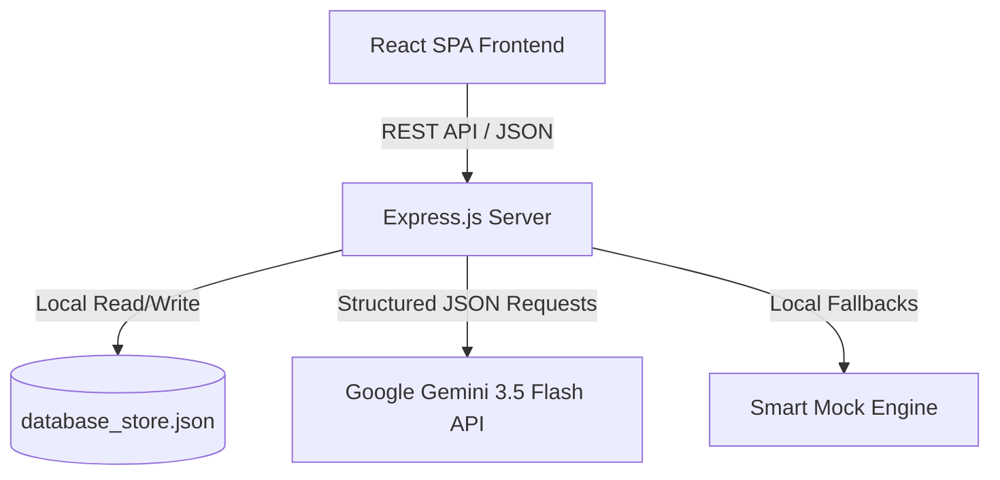

# 📄 Product Requirements Document (PRD)
## Project: Predictor.AI — AI-Powered Placement Readiness Predictor

---

## 1. Document Control & Metadata

| Field | Description |
| :--- | :--- |
| **Document Title** | Product Requirements Document (PRD) — Predictor.AI |
| **Version** | 1.0.0 |
| **Status** | Approved / Active |
| **Target Audience** | Software Engineers, QA Engineers, Product Managers, Academic Administrators |
| **Author** | Antigravity AI Coding Assistant |
| **Date** | June 2026 |

---

## 2. Executive Summary & Vision

### 2.1 Problem Statement
University campus placement programs often struggle to assess the industry readiness of students. Academic grades (CGPA) alone do not correlate directly with practical coding skills, communication fluency, system design knowledge, or CV alignment with target job profiles. Students lack real-time feedback on their preparation, while campus coordinators lack aggregated data to track cohort readiness, resulting in poor placement conversions.

### 2.2 Solution
**Predictor.AI** is an AI-driven, full-stack student placement preparation and analytics platform. The application provides students with simulated LeetCode-style coding runs, multi-turn AI technical interviews, and automated ATS resume screening. The platform calculates a composite **Placement Readiness Index (PRI)** and generates a tailored study roadmap. Simultaneously, it provides administrators with a central panel to track classroom eligibility and academic stats.

### 2.3 Product Vision
To establish an automated, data-driven bridge between academic training and industry eligibility, ensuring every student has a personalized preparation path and every academic institution has clear insights into cohort performance.

---

## 3. User Personas

The system serves two distinct user roles:

### 3.1 Student
*   **Needs**: Practice core coding questions, optimize resume text for ATS, practice technical interviews, identify skill gaps, and get a weekly study plan.
*   **Key Journeys**:
    1.  Create an account and complete their academic profile.
    2.  Solve problems in the coding sandbox with real-time feedback.
    3.  Upload their resume and receive keyword optimization tips.
    4.  Engage in a live chat mock interview and receive a scorecard.
    5.  Review their readiness score and study the personalized roadmap.

### 3.2 Coordinator / Administrator
*   **Needs**: Monitor the class readiness index, search student performance, identify struggling candidates, and evaluate graduation metrics.
*   **Key Journeys**:
    1.  Access the central dashboard to check cohort metrics.
    2.  Review graphs showing CGPA ranges, skill domains, and readiness tiers.
    3.  Search the student roster to check individual profiles, CGPA, target roles, and readiness scores.

---

## 4. Functional Requirements

### Epic 1: Authentication & Session Management
*   **Req 1.1**: The platform must support two user roles: `student` and `admin`.
*   **Req 1.2**: User credentials must be validated via a secure server endpoint (`/api/auth/login`).
*   **Req 1.3**: Student registrations require name, email, password, and confirmation of role type.
*   **Req 1.4**: Active sessions must be persisted in local storage (`predictor_session_user`) to survive page refreshes.

### Epic 2: Academic Profile & Skill Management
*   **Req 2.1**: Students can define their graduation year, current CGPA, preferred job title (e.g., Frontend Developer), technical skills list, and URLs for GitHub and LeetCode.
*   **Req 2.2**: Changing academic variables must recalculate the student's profile completeness score.

### Epic 3: Placement Readiness Index (PRI) Engine
*   **Req 3.1**: The system must calculate a composite score from 0 to 100 based on weighted metrics:
    $$\text{PRI} = (\text{Coding} \times 0.35) + (\text{Interview} \times 0.25) + (\text{Resume} \times 0.20) + (\text{Profile} \times 0.20)$$
*   **Req 3.2**: The engine must categorize readiness into tiers:
    *   **Excellent Match** (PRI $\ge 90$): High readiness across coding, interviews, and CV.
    *   **Ready with Minor Gaps** (PRI $75$–$89$): Ready for placement but needs minor roadmap study.
    *   **Developing** (PRI $50$–$74$): Needs coding practice and CV optimization.
    *   **Needs Attention** (PRI $< 50$): Requires immediate mentoring and core practice.
*   **Req 3.3**: The system must generate a dynamic text summary based on the resulting tier.

### Epic 4: Monaco Algorithmic Coding Sandbox
*   **Req 4.1**: Provide a full-screen, LeetCode-style code editor integrated with the Monaco Editor.
*   **Req 4.2**: Support language selection templates for JavaScript, TypeScript, Python, Java, C++, and C.
*   **Req 4.3**: Provide a **"Run Code"** feature to test solutions against public inputs, displaying expected vs. actual values.
*   **Req 4.4**: Provide a **"Submit Code"** feature to execute solutions against all test cases and save the results.
*   **Req 4.5**: Provide an **"AI Coach"** panel offering contextual feedback categories:
    *   **Explain**: Explains the data structure logic behind the problem.
    *   **Hint**: Gives progressive clues without showing the code.
    *   **Debug**: Locates compiler errors or logical traps.
    *   **Optimize**: Suggests how to improve runtime complexity (e.g., from $O(N^2)$ to $O(N)$).
    *   **Complexity**: Analyzes Big-O time and space complexities.
    *   **Interview**: Discusses common interview edge cases.

### Epic 5: AI Mock Technical Interviewer
*   **Req 5.1**: Provide a live chat interface with an AI interviewer, **Dr. Sarah Jenkins**.
*   **Req 5.2**: The interview must follow a structured 6-turn dialogue before automatically ending.
*   **Req 5.3**: After completion, the AI must evaluate the transcript and return:
    *   An overall score out of 100.
    *   Grades for Technical Accuracy, Communication, and Problem Solving.
    *   Key strengths and areas for improvement.

### Epic 6: ATS Resume CV Screener
*   **Req 6.1**: Students can upload or paste text-based CVs.
*   **Req 6.2**: The ATS scanner compares CV keywords with target role expectations.
*   **Req 6.3**: The scanner outputs an overall ATS score, matched strengths, weaknesses, and suggests 6 high-impact keywords.

### Epic 7: Dynamic Skill Gap & Roadmap Planner
*   **Req 7.1**: The platform must display gaps between a student's current skills and their target role.
*   **Req 7.2**: Generate a structured 6-week study curriculum divided into three 2-week milestones, complete with estimated hours and learning resources.

### Epic 8: Administration Command Center
*   **Req 8.1**: The dashboard must display cohort statistics: total students, average readiness scores, and completed assessments.
*   **Req 8.2**: Embed charts showing class performance distributions: CGPA scales, student focus domains, and score tier distributions.
*   **Req 8.3**: Include a searchable roster listing each student's name, target role, domain, CGPA, readiness score, and tier.

---

## 5. Technical Architecture & Data Models

The system is built on a fullstack Express and React architecture. It mounts Vite dev middleware in development mode and serves compiled static files in production.



### 5.1 Database Schema (JSON Structure)
The local database stores information in the following JSON format:

```typescript
export interface User {
  id: string;
  email: string;
  name: string;
  role: 'student' | 'admin';
  createdAt: string;
}

export interface StudentProfile {
  userId: string;
  fullName: string;
  domain: string;
  graduationYear: string;
  currentCgpa: number;
  preferredRole: string;
  skills: string[];
  githubUrl?: string;
  leetcodeUrl?: string;
  experience?: string;
  projects?: string;
  updatedAt: string;
}

export interface CodingAssessment {
  id: string;
  title: string;
  difficulty: 'Easy' | 'Medium' | 'Hard';
  description: string;
  initialCode?: string;
  language?: string;
  starterTemplates?: { [lang: string]: string };
  testCases: { input: string; expected: string; hidden?: boolean }[];
}

export interface AssessmentSubmission {
  id: string;
  userId: string;
  assessmentId: string;
  code: string;
  status: 'Solved' | 'Failed' | 'Draft';
  score: number;
  feedback: string;
  submittedAt: string;
}

export interface ResumeAnalysis {
  id: string;
  userId: string;
  score: number;
  summary: string;
  strengths: string[];
  weaknesses: string[];
  suggestedKeywords: string[];
  originalFileName: string;
  analyzedAt: string;
  resumeText?: string;
}

export interface InterviewMessage {
  id: string;
  role: 'interviewer' | 'candidate';
  content: string;
  timestamp: string;
}

export interface InterviewSession {
  id: string;
  userId: string;
  roleType: string;
  startedAt: string;
  messages: InterviewMessage[];
  completed: boolean;
  overallScore?: number;
  feedbackSummary?: string;
  detailedFeedback?: {
    technicalAccuracy: number;
    communication: number;
    problemSolving: number;
    keyStrengths: string[];
    improvements: string[];
  };
}

export interface SkillRoadmap {
  id: string;
  userId: string;
  createdAt: string;
  skillGaps: {
    skill: string;
    currentLevel: 'None' | 'Beginner' | 'Intermediate' | 'Advanced';
    requiredLevel: 'Beginner' | 'Intermediate' | 'Advanced';
    importance: 'High' | 'Medium' | 'Low';
    gapStatus: 'Acquired' | 'Gap' | 'In Progress';
  }[];
  roadmapSteps: {
    week: string;
    milestone: string;
    description: string;
    estimatedHours: number;
    resources: { title: string; type: 'Video' | 'Article' | 'Practice'; url: string }[];
  }[];
}

export interface PlacementReadinessResult {
  userId: string;
  overallScore: number;
  codingScore: number;
  resumeScore: number;
  profileScore: number;
  interviewScore: number;
  decisionStatus: 'Excellent Match' | 'Ready with Minor Gaps' | 'Developing' | 'Needs Attention';
  insightSummary: string;
  lastUpdated: string;
}
```

### 5.2 API Endpoints Matrix

| Endpoint | Method | Payload / Params | Response | Description |
| :--- | :--- | :--- | :--- | :--- |
| `/api/auth/login` | `POST` | `{ email, password }` | `{ user }` | Validates credentials and starts session. |
| `/api/auth/register` | `POST` | `{ email, name, password, role }` | `{ user }` | Registers a new account. |
| `/api/profile/:userId` | `GET` | None | `StudentProfile` | Retrieves a student's profile. |
| `/api/profile/:userId` | `POST` | `Partial<StudentProfile>` | `StudentProfile` | Updates profile fields and updates PRI. |
| `/api/assessments` | `GET` | None | `CodingAssessment[]` | Retrieves all coding challenges. |
| `/api/assessments/:id` | `GET` | None | `CodingAssessment` | Retrieves a specific coding challenge. |
| `/api/assessments/execute` | `POST` | `{ userId, assessmentId, code, language, customInput, isSubmit }` | `SandboxResponse` | Compiles and grades code via Gemini or offline fallback. |
| `/api/assessments/ai-assist` | `POST` | `{ userId, problemId, code, language, requestType }` | `{ response: string }` | Provides AI hints, debugging tips, or complexity explanations. |
| `/api/resume/analyze` | `POST` | `{ userId, filename, resumeText, preferredRole }`| `ResumeAnalysis` | Performs ATS scan on CV text. |
| `/api/interview/start` | `POST` | `{ userId, roleType }` | `InterviewSession` | Creates a new technical interview room. |
| `/api/interview/respond`| `POST` | `{ sessionId, userMessage }` | `{ message, concluded }` | Submits candidate answer; returns AI question. |
| `/api/interview/complete`| `POST` | `{ sessionId }` | `InterviewSession` | Grades interview transcripts. |
| `/api/roadmap/:userId` | `GET` | None | `SkillRoadmap` | Retrieves the custom study roadmap. |
| `/api/roadmap/:userId/generate` | `POST` | None | `SkillRoadmap` | Generates a new roadmap. |
| `/api/admin/analytics` | `GET` | None | `AdminAnalytics` | Retrieves aggregated classroom stats. |
| `/api/admin/students` | `GET` | None | `StudentRosterItem[]` | Retrieves list of students. |

### 5.3 Google Gemini AI Integration
The backend uses `gemini-3.5-flash` with JSON schemas to ensure API compatibility.

#### Code Grader prompt workflow:
```typescript
const promptCommand = `
You are a sandboxed program compiler and runner.
We need to run the following user source code written in "${language}" for the coding problem "${problem.title}".

Problem Description:
${problem.description}

Constraints:
${JSON.stringify(problem.constraints || [])}

User Code:
\`\`\`${language}
${code}
\`\`\`

Test Cases to run:
${JSON.stringify(casesToRun)}

Execute this code logically as if it was running inside a high-speed secure platform terminal.
Determine if it compiles successfully or has syntax errors. If there is a syntax/runtime error, set compiledSuccessfully to false, and populate compilerMessage with the exact compiler or interpreter logs.
If the code compiles successfully, run the code for EACH test case. Extract console stdout/logs if any, find the final returned/printed value, compare it to the expected output, and return the testResults.
Estimate the realistic runtime speed in milliseconds (e.g. "12ms", "145ms") and memory footprint in megabytes (e.g. "12.4 MB") of this program.
`;
```

To enforce structured JSON, the API defines the schema schema parameters:
- `compiledSuccessfully` (Boolean)
- `compilerMessage` (String)
- `runtime` (String, e.g., `"12ms"`)
- `memory` (String, e.g., `"14.5 MB"`)
- `testResults` (Array of objects detailing `input`, `actual`, `expected`, and `passed`)

### 5.4 Smart Offline Fallback Mode
If no `GEMINI_API_KEY` is found in the environment, the server switches to local processing:
- **Coding Sandbox**: Runs code using a clean local JavaScript `Function` constructor, capturing outputs and comparing them against expected values.
- **ATS Scan**: Runs standard text search heuristics to check for keyword matches relative to the selected role.
- **Mock Interview**: Serves pre-configured technical questions on scalability, caching, security, and performance.
- **Roadmaps**: Generates pre-built curricula matching the user's selected domain.

---

## 6. Non-Functional Requirements

### 6.1 Performance & Latency
*   **AI Responses**: Large language model calls should return in under 5 seconds.
*   **Offline Mode**: Local sandbox executions must return results in under 50 milliseconds.
*   **Hot Module Replacement**: Vite must refresh code changes in under 300 milliseconds.

### 6.2 Security & Integrity
*   **Simulated Compilation**: Arbitrary code submitted by students must not be executed directly on the server host environment unless checked by the simulated sandbox schema.
*   **Database Access**: JSON reading and writing must run inside try-catch structures to prevent corrupting database files.

### 6.3 Usability & Aesthetics
*   **Color Palette**: Modern dark interface using dark backgrounds (`#09090b` / `#121214`) accented with emerald green highlights (`#10b981`).
*   **Responsive Layout**: Designs must adjust to mobile viewports via a slide-out hamburger menu.
*   **Typographic Hierarchy**: Distinct sans-serif text (UI elements) combined with monospace fonts (code syntax elements).

---

## 7. Verification & Testing Plan

### 7.1 Automated Verification Checks
- **TypeScript Compilation**: Run `npm run lint` to verify type safety.
- **Production Bundling**: Run `npm run build` to verify esbuild bundling.
- **API Tests**: Confirm backend ports bind successfully on `0.0.0.0:3000`.

### 7.2 Manual Quality Assurance Actions
1.  **Auth Registration**: Register a student, check if a profile is created in `database_store.json`, and verify login redirection.
2.  **DSA Code Executions**: Submit correct and incorrect code blocks to verify that test results are displayed properly.
3.  **ATS Keywords Audit**: Paste a CV missing key terms to ensure score adjustments and keyword recommendations function correctly.
4.  **AI Conversation Loops**: Run the mock interview chat to check that it concludes after 6 turns and displays a scorecard.
5.  **Admin Portal**: Log in as `admin@predictor.com` and verify that the cohort metrics match student data.
